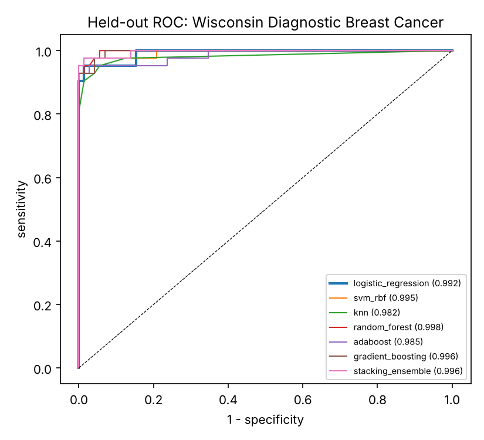
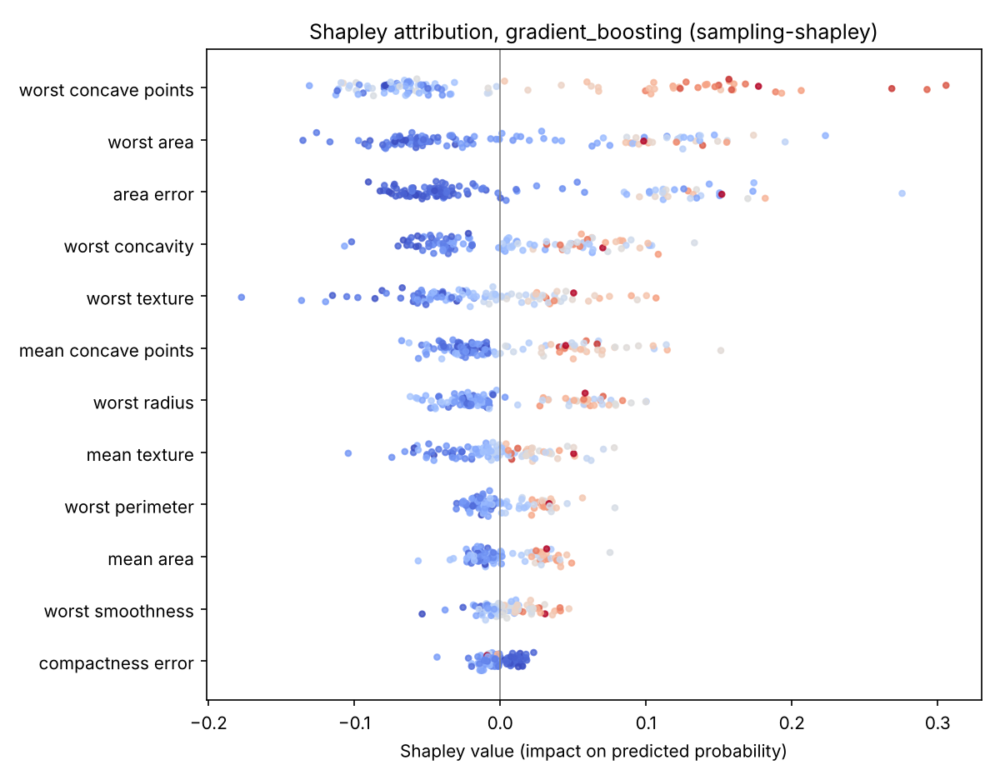
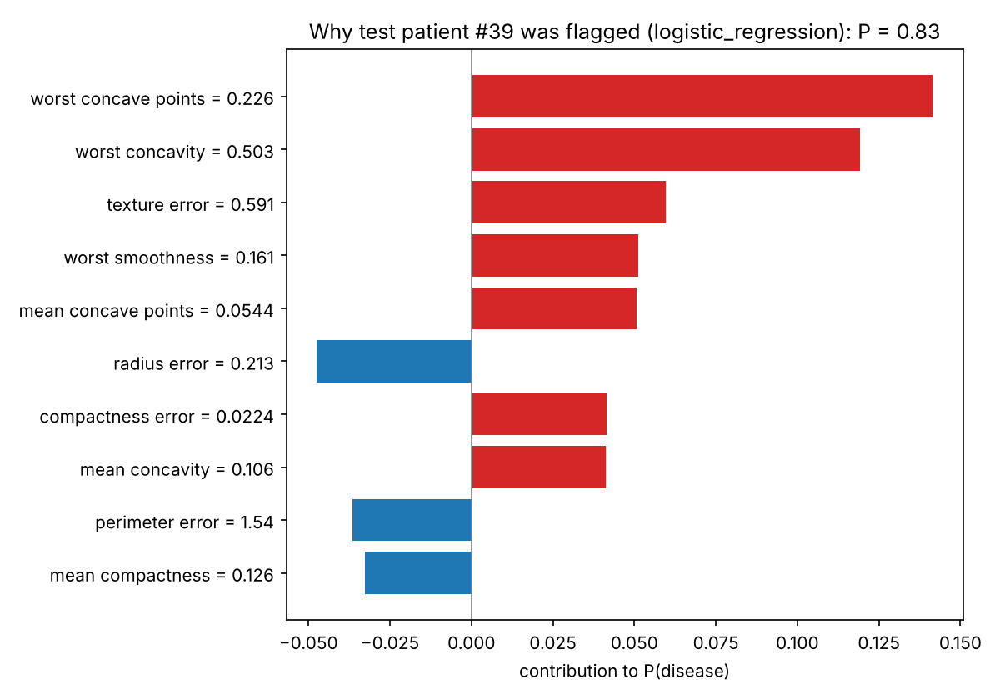

# Explainable Machine Learning for Early Disease Diagnosis

[](https://github.com/raiyanmuntasir/explainable-disease-prediction/actions/workflows/ci.yml)


A reproducible, leakage-safe benchmark of classical, ensemble and stacked classifiers for early disease detection from tabular clinical data. It reports clinically meaningful metrics and patient-level Shapley explanations.

This is an open implementation of the methodology described in:

> Asad, S. M., Hussain, M. A., Monim, R. M., & Islam, K. (2022). *Application of machine learning for early disease diagnosis in healthcare.* Cuestiones de Fisioterapia, 51(3), 332–355.

> Hussain, M. A., Rahman, M. R., Islam, K., Alim, M. A., Sultana, S., Asad, S. M., & Monim, R. M. (2026). *AI-driven predictive analytics for intelligent healthcare monitoring and early disease detection.* Journal of Posthumanism, 6(2), 748–771. https://doi.org/10.63332/joph.v6i2.4020

The results below come from running this repository's code. They are not copied from the papers.

## What the pipeline does

```
median imputation → standardisation → [PCA] → SMOTE (training folds only) → classifier
```

* **Models:** logistic regression, RBF-SVM (Platt-calibrated), k-NN, random forest, AdaBoost, gradient boosting, XGBoost (used automatically when installed), and a **stacked ensemble** (SVM + RF + GB + k-NN → logistic meta-learner).
* **Leakage-safe SMOTE:** oversampling happens inside `fit`, so synthetic patients never appear in validation or test folds. `imbalanced-learn` is used when installed, otherwise a tested NumPy implementation.
* **Evaluation:** a stratified 80/20 development/test split, plus 5×5 repeated stratified CV on the development set. Metrics are ROC-AUC, AUPRC, F1, **MCC**, sensitivity, specificity and **Brier score**, with bootstrap 95% CIs on the held-out test set.
* **Model selection:** highest CV ROC-AUC, with near-ties broken by calibration (Brier), because a probability that is going to be shown to a clinician should mean what it says.
* **Explainability:** Shapley values (via `shap` when installed, otherwise an exact-additivity Monte Carlo estimator), global beeswarm plots, patient-level "why was this patient flagged" plots, and permutation importance.

## Results: Wisconsin Diagnostic Breast Cancer

569 patients, 30 cytology features, malignant = positive (37.3%). Reproduce with `python -m diseasepred`.

**Repeated 5×5 stratified CV (development set), mean ± sd**

| Model | ROC-AUC | MCC | Sensitivity | Specificity | Brier |
|---|---|---|---|---|---|
| Logistic regression (selected) | 0.994 ± 0.007 | 0.943 ± 0.034 | 0.958 ± 0.028 | 0.982 ± 0.020 | **0.021** |
| Stacked ensemble | 0.994 ± 0.006 | 0.941 ± 0.034 | 0.955 ± 0.030 | 0.982 ± 0.017 | 0.022 |
| SVM (RBF) | 0.994 ± 0.006 | 0.938 ± 0.036 | 0.964 ± 0.030 | 0.975 ± 0.020 | 0.023 |
| AdaBoost | 0.994 ± 0.006 | 0.939 ± 0.032 | 0.945 ± 0.030 | 0.987 ± 0.016 | 0.113 |
| Gradient boosting | 0.990 ± 0.009 | 0.914 ± 0.046 | 0.947 ± 0.037 | 0.966 ± 0.025 | 0.031 |
| Random forest | 0.990 ± 0.007 | 0.910 ± 0.043 | 0.944 ± 0.034 | 0.966 ± 0.030 | 0.034 |
| k-NN | 0.987 ± 0.013 | 0.924 ± 0.036 | 0.941 ± 0.033 | 0.978 ± 0.018 | 0.030 |

**Held-out test set (114 patients):** logistic regression ROC-AUC 0.992 (95% CI 0.977–1.000), sensitivity 0.952, specificity 0.986. That is 2 missed cancers and 1 false alarm. Full tables: [`results/breast_cancer/RESULTS.md`](results/breast_cancer/RESULTS.md).

<p align="center"></p>

**Findings worth stating plainly:**

* On this well-separated dataset, the top four models are statistically indistinguishable in ROC-AUC. The interpretable, well-calibrated logistic regression is the right choice. Ensembles add complexity without a measurable gain here.
* AdaBoost ranks as well as the others but is badly calibrated (Brier 0.113 vs about 0.02). Ranking metrics alone would hide that.
* SMOTE and PCA make no measurable difference at a 37% prevalence (ablation table in `RESULTS.md`). SMOTE is expected to matter more on rarer outcomes.

### Explanations

| Global attribution (gradient boosting) | Why one patient was flagged (logistic regression) |
|---|---|
|  |  |

Shapley values sum exactly to each patient's predicted probability minus the baseline (maximum additivity error about 3e-16). In both models, irregular cell-nucleus shape features (*worst concave points*, *worst concavity*) and nucleus size (*worst area / radius*) drive malignancy predictions, which matches cytopathology practice.

## Quick start

```bash
git clone https://github.com/raiyanmuntasir/explainable-disease-prediction.git
cd explainable-disease-prediction
pip install -r requirements.txt            # add `xgboost shap imbalanced-learn` for the optional backends

python -m diseasepred                      # breast cancer (bundled with scikit-learn)
python -m diseasepred --dataset pima       # Pima Indians Diabetes (downloads from OpenML)
python -m diseasepred --dataset csv --csv heart.csv --target target   # any binary-outcome CSV
python -m unittest discover -s tests -t .
```

Each run writes metrics CSVs, figures and a `RESULTS.md` to `results/<dataset>/`.

## Layout

```
diseasepred/
  data.py      dataset loaders (breast cancer, Pima diabetes, any CSV)
  smote.py     leakage-safe SMOTE and SMOTEClassifier wrapper
  models.py    model zoo, stacking ensemble, shared preprocessing pipeline
  evaluate.py  repeated CV, clinical metrics, bootstrap confidence intervals
  explain.py   Shapley values, global/local plots, permutation importance
  cli.py       end-to-end experiment and report
tests/         unit tests (SMOTE correctness, Shapley additivity, CV sanity)
```

## Limitations

The data are public research datasets, so results do not transfer automatically to other populations or acquisition settings. This software is for research and education. It is not a medical device.

## License

MIT © Raiyan Muntasir Monim
